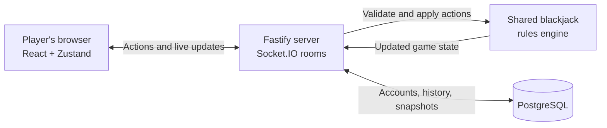

# Felt — Multiplayer Blackjack

Play blackjack with friends at a private, real-time table. Create a room, share its invite code, and play together in your browser — no account is needed to join a game.

[**▶ Play Felt**](https://blackjack-5d7w.onrender.com) · [**View the source code**](https://github.com/raheelhparekh/blackjack)

## What you can do

- **Create or join a private table** — invite friends with a room code.
- **Play live together** — see turns and table updates in real time.
- **Choose table rules** — configure decks, blackjack payout, dealer behavior, and bet limits.
- **Use familiar blackjack actions** — hit, stand, double down, split, and make insurance decisions.
- **Chat and follow the table** — use in-game chat, standings, and activity updates.
- **Keep track of your play** — optional accounts provide access to saved session history.
- **Recover from interruptions** — the server saves room snapshots so active sessions can be restored.

## How it works

The browser sends player actions to the server. The server checks and applies the game rules, then broadcasts each player's appropriate table view to everyone in the room. PostgreSQL stores account and session data.



## Codebase at a glance

| Folder                               | What it contains                                                           |
| ------------------------------------ | -------------------------------------------------------------------------- |
| [`apps/web`](apps/web)               | React interface: landing page, lobby, game table, and dialogs              |
| [`apps/server`](apps/server)         | Fastify API, Socket.IO multiplayer server, authentication, and persistence |
| [`packages/shared`](packages/shared) | Blackjack rules engine, shared types, and client/server message schemas    |

The shared rules package keeps game decisions on the server side rather than trusting browser-submitted game state. The server also creates player-specific views of the table, including protection for hidden dealer cards.

## Built with

- **Frontend:** React, TypeScript, Vite, Tailwind CSS, Zustand, Framer Motion
- **Backend:** Node.js, Fastify, Socket.IO
- **Rules and validation:** shared TypeScript game engine, Zod
- **Data:** PostgreSQL, Drizzle ORM
- **Checks:** Vitest, ESLint, Prettier
- **Hosting:** Render

## Run locally

Requirements: Node.js 22 or newer and pnpm 9 or newer.

```bash
cp .env.example .env
pnpm install
pnpm dev
```

The web app runs on port `5173` and the server on port `3001`. Set `DATABASE_URL` and `JWT_SECRET` in `.env` for local configuration; the example file explains the available settings.

## Checks

```bash
pnpm test       # Run shared-engine and server tests
pnpm typecheck  # Type-check workspace packages
pnpm lint       # Lint JavaScript and TypeScript with ESLint
pnpm format:check # Check formatting with Prettier
pnpm build      # Build shared package, server, and web app
```

## Deployment

The app is deployed on Render. [`render.yaml`](render.yaml) describes the web service and PostgreSQL database; Render builds the production image with the root [`Dockerfile`](Dockerfile).
